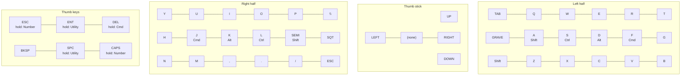
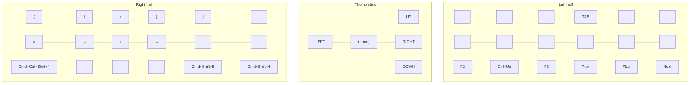
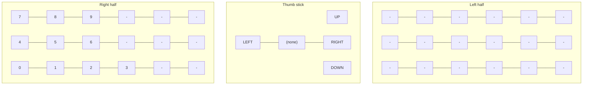

# Eyelash Corne ZMK Config

ZMK firmware config for an **Eyelash Peripherals Corne** (`eyelash_corne` shield),
built on nice!nano v2 with a nice!view display on each half.

> This is **not** a foostan Corne. It is a 48-key, 5-row matrix and will not
> work with standard `corne` firmware.

## Hardware

| Part           | Detail                                                                                     |
| -------------- | ------------------------------------------------------------------------------------------ |
| Board          | `nice_nano_v2` ×2                                                                          |
| Shield         | `eyelash_corne_left` / `eyelash_corne_right` (from a741725193/zmk-new_corne)               |
| Display        | nice!view on both halves                                                                   |
| Thumb scroller | EC11 encoder, **left half** — bound to volume (CCW down, CW up)                            |
| Thumb stick    | 4 matrix keys (`UP` `LEFT` `RIGHT` `DOWN`) — arrow keys, not a pointer; centre key unbound |

## Layout

48 keys over 5 rows, split across two halves. The thumb cluster has 3 keys
per side; the stick sits between the halves in the upper-middle.

Legend: `key` = tap, `key / hold` where a key has two functions.
`-` = transparent placeholder (inherits from the layer below),
`(none)` = no binding at all.

### Layer 0 — Base

### Layer 1 — Utility

Held from the left `ENT` thumb or the right `SPC` thumb.

### Layer 2 — Number

Held from the left `ESC` thumb or the right `CAPS` thumb.

### Thumb scroller

On the **left half**. Rotating it sends volume keys on every layer.

| Direction         | Sends      |
| ----------------- | ---------- |
| Clockwise         | `C_VOL_UP` |
| Counter-clockwise | `C_VOL_DN` |

## Build & flash

Pushes trigger GitHub Actions; download artifacts from the **Actions** tab.

| Artifact                    | Flash to                                    |
| --------------------------- | ------------------------------------------- |
| `eyelash_corne_right`       | right half                                  |
| `eyelash_corne_studio_left` | left half (central, enables ZMK Studio)     |
| `settings_reset`            | either half, only to re-pair the two halves |

To flash: connect USB, double-tap **reset** within 0.5 s, then drag the
`.uf2` onto the mounted drive. Do not delete anything on the drive.

## Notes

- The shield, ZMK fork and required modules are pulled in via `config/west.yml`.
- Encoder direction is set in `config/eyelash_corne.keymap` (`rsr_vol`);
  swap `cw-binding` / `ccw-binding` if volume moves the wrong way.
- Hold `Q + S + Z` for 2 s to soft off.
- Settings (RGB, backlight, sleep, NKRO, debounce) live in `config/eyelash_corne.conf`.
