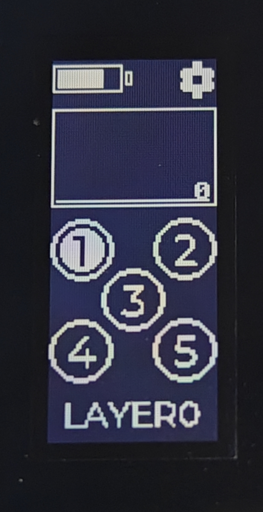

# End-user Behaviour Reference

Condensed from the shipped user manual. Everything here is what the keyboard does by default — useful when answering "why doesn't my key do X?" without loading the full manual.

## Flashing

1. Connect the half with a **data** USB cable.
2. Double-click **reset** within 0.5 s → a drive named `nicenano` mounts.
3. Copy **one** `.uf2` to the drive root. The drive unmounts itself when done (macOS may show an error — ignore it).
4. Never delete files from the drive; never copy several `.uf2` at once.

`settings_reset` clears the left/right pairing (and does not distinguish left from right). Flash it to **both** halves, then flash `left` and `right`.

Blue LED: breathing = bootloader with USB host attached; fast flash = bootloader with no host; off = ZMK running.

## Power and charging

| Item          | Behaviour                                                                     |
| ------------- | ----------------------------------------------------------------------------- |
| Slide switch  | down = on (Corne, both halves). Must be on to charge.                         |
| Green LED     | solid = charging · flashing = battery disconnected or switch off · off = full |
| Charging time | ~6–8 h depending on capacity                                                  |

The battery has a protection board and stops charging when full. Only switch the keyboard fully off if it will be unused for more than ~6 months. The battery switch has a shorter life than the reset switch, so for carrying use `soft_off` instead.

## Bluetooth profiles

- Five profiles; each binds to **one** host (computer/tablet/phone).
- `BT_SEL_0` … `BT_SEL_4` select a profile; `BT_CLR` clears the current one; `BT_CLR_ALL` clears all.
- A host can only be connected to one profile. If you switch profiles by accident, keystrokes stop reaching the previous host while the screen still looks normal.
- With a plug in the USB-C port, reports go to USB by default; `OUT_BL` forces Bluetooth, `OUT_USB` forces USB.

## Keyboard state keycodes

| Keycode                       | Effect                                             |
| ----------------------------- | -------------------------------------------------- |
| `&sys_reset`                  | restart (also refreshes the screen)                |
| `&bootloader`                 | enter UF2 flashing mode                            |
| `&soft_off`                   | deep sleep; the only wake is pressing reset once   |
| `&ext_power EP_OFF` / `EP_ON` | legacy LED-rail control; removed on newer firmware |

`soft_off` shortcut documented for the low-profile boards: hold **Q + S + Z** for two seconds.

## Display and receiver half

See [Keymap diagrams](keymap-diagrams.md) for the layer pictures, and the notes below for what the screen shows:

- **1–5** — Bluetooth profiles.
- **Gear** — profile unused. **×** — profile saved but not connected. **Wi-Fi icon** — connection to the host is healthy.
- **× in the top-right of the peripheral half's screen** — halves not linked (the Wi-Fi icon can lie when the link is lost; judge by keypresses or synchronised RGB).
- **`LAYER0` at the bottom** — the active layer; its name comes from `display-name` in the keymap.
- The box under the battery icon is a decorative typing-speed widget.

## DYA STUDIO (real-time re-keying)

- Web version: <https://studio.dya.cormoran.works/> (use the PC EXE only if you have it from the shop).
- Connect the **main** half by cable; if several ports are offered, try them until the keymap loads.
- Click **Save** in the top-right before closing — auto-save can fail and revert the keymap.
- Changing the encoder requires a delay value of **≥ 50 ms**.
- Firmware must have been built with Studio support (all `new-dya studio version` builds are).

Behavior names in Studio map to ZMK behaviours: Key Press → `&kp`, Mod Tap → `&mt`, Momentary Layer → `&mo`, Layer-tap → `&lt`, Transparent → `&trans`, None → `&none`. Full lists: [Config options](config-options.md) and <https://zmk.dev/docs/keymaps/behaviors>.
